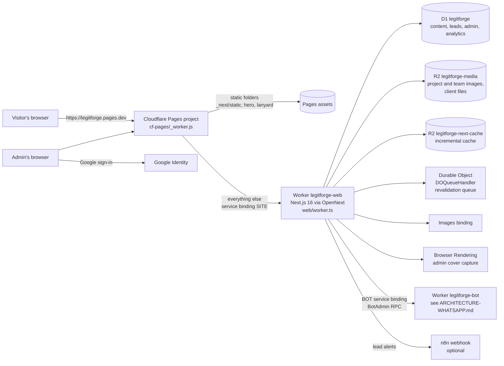

# Legit Forge website: architecture

The public site and its admin, as built (October 2026). The WhatsApp automation is a separate
system with its own document: [ARCHITECTURE-WHATSAPP.md](ARCHITECTURE-WHATSAPP.md). The two meet in
exactly three places, listed at the end.

## 1. What runs where



- **Cloudflare Pages** (`cf-pages/`) is the public address. It serves the static folders listed in
  `cf-pages/_routes.json` (`_next/static`, `hero`, `lanyard`) and forwards every other request to the
  Worker through the `SITE` service binding. The Worker has no public address of its own
  (`workers_dev: false`).
- **The Worker** (`web/worker.ts`) is OpenNext's handler plus two fixes that only show on
  Cloudflare: HTML goes through `lib/doctype-first.ts` (no quirks mode), and `keep_names: false`.
  Crons: every 5 minutes it retries queued lead alerts; at 03:00 it prunes short-lived tables.
- Workers Free: the bundle is 2,877 KiB gzip (limit 3,072 KiB; measured 18 Oct 2026, dry-run).

## 2. Rendering and data

| Layer | How it works | Where |
|---|---|---|
| Pages | App Router server components, prerendered at build and tagged (`projects`, `team`, `testimonials`, `company`). An admin save calls `updateTag`, so the next request re-renders. No page sets `dynamicParams = false`. | `app/`, `lib/build-cache.ts` |
| Copy | Home copy in `lib/content.ts`, inner pages in `lib/pages.ts`; passed to client components as props. | `lib/` |
| Live data | Projects, people, testimonials and company details come from D1 through `lib/work.ts`, `lib/team.ts`, `lib/company.ts`; never read during `next build`. | `lib/` |
| Client code | Small islands: GSAP after hydration (`useGsap`), Lenis on fine pointers, the 3D team cards only near #team, `HydrateWhenNear` for below-the-fold sections, the chat bubble (button only; the panel on first tap). | `components/` |
| Styling | Tailwind v4 and theme tokens in `app/globals.css` (Tempered Steel: black and gold; never red or orange). Anybody font self-hosted. | `app/globals.css` |
| SEO | `robots.ts`, `sitemap.ts`, `llms.txt`, JSON-LD built from Admin data (`lib/team-seo.ts`), breadcrumbs on every inner page, static share images (`lib/og.tsx`). | `app/` |

### D1 tables (migrations 0001–0017)

`projects`, `project_images`, `team_members`, `member_projects`, `testimonials`, `company` (site
content, Admin) · `leads`, `lead_receipts`, `lead_alert_outbox` (enquiries and their delivery) ·
`events`, `site_stats`, `rate_events` (aggregate analytics, 13 months, no personal data) ·
`admin_emails`, `admin_sign_ins`, `admin_security`, `github_app` (admin access) · `demo_sessions`,
`wa_processed`, `wa_optouts` (older, unused) · `bot_team`, `bot_settings`, `bot_replies`,
`bot_limits`, `bot_phrases` (written by the admin, read by the bot).

## 3. The enquiry form

```mermaid
sequenceDiagram
  participant V as Visitor
  participant API as POST /api/leads
  participant D1 as D1 leads
  participant Q as lead_alert_outbox
  participant N as n8n (optional)
  participant BOT as WhatsApp bot (cron)
  V->>API: form (validated: lib/server/lead-http.ts)
  API->>D1: store the lead first (lead-storage.ts)
  API-->>V: 200 "we will reply within 2 hours"
  API->>Q: queue the alert (after the response)
  Q->>N: deliver; retried by the */5 cron, status visible in Admin → Leads
  BOT->>D1: every 2 min: new form leads (wa_alerted_at is null)
  BOT->>BOT: alert the team on WhatsApp, in turns
```

A lead is stored before any notification, and its delivery state stays visible in Admin → Leads
even when n8n is missing or fails.

## 4. The admin

- **Sign-in** is Google only (`lib/admin/auth.ts`): the ID token is verified (Google's keys, the
  client id, `email_verified`, a one-use nonce), then an HMAC-signed `__Host-lf_admin` cookie.
  Every request re-checks the cookie and the allow-list (owners in `ADMIN_EMAILS` plus D1
  `admin_emails`). "Sign out everywhere" refuses older sessions.
- **Every Server Action and admin route calls `requireAdmin()` itself** (actions are public POST
  endpoints). `/admin/*` sends an enforced CSP and `X-Frame-Options: DENY`.
- Sections: Leads (with files, export, the WhatsApp chat viewer), Projects (incl. "Add from GitHub"
  and private repos through a GitHub App), Team, Testimonials, Company, Access, and **WhatsApp**
  (dashboard and health, open questions, what the bot knows, settings, phrases). The WhatsApp
  pages read the bot only through the `BOT` binding: the website holds no Supabase key.

## 5. Deploy

`.github/workflows/deploy-cloudflare.yml`, in order: secrets check → typecheck and backend tests
→ OpenNext build → the local release gate (`scripts/preflight.mjs`: isolated D1 and R2, smoke,
mocked enquiries, access, trust opening, service pages, the chat bubble, the three-viewport audit,
a phone measurement) → D1/R2/site URL setup → a pre-migration D1 bookmark → migrations → **the bot
Worker** (the site's `BOT` binding needs it) → the checked site Worker → mark the data tags changed
→ Pages → first-run secrets → a read-only production smoke matching the build revision. Laptop
deploys follow the README recipe (an isolated wrangler login, the right account).

## 6. Performance and safety rules that shape the code

- Measured at 360 px with 4–6× CPU throttling; lite mode (`html[data-lite]`) changes only the
  order of work. Animations use transform, opacity, filter, clip-path and custom properties.
- The public CSP is report-only and `npm run check` fails on any violation; the admin CSP is
  enforced.
- Analytics keep counts only (no names, numbers, messages, IPs or sessions).

## 7. Where the website meets the WhatsApp automation

1. **The `BOT` service binding** (website → bot): Admin → WhatsApp and the chat viewer call the
   bot's private `BotAdmin` RPC, and the chat bubble's `/api/chat` forwards to `BotAdmin.fetch`.
   The bot's own address is never on the site.
2. **Shared D1** (both write): the bot writes WhatsApp, website-chat, Messenger and Instagram
   enquiries into `leads` (source `whatsapp`, the channel as `page`) and reads the admin's
   `bot_*` tables; it never applies migrations (the site deploy does).
3. **Shared code** (`lib/` only): `lib/wa-services.ts` (service keys, channel labels),
   `lib/business-hours.ts`, `lib/site.ts`. Nothing in `app/` or `lib/` imports `bot/`.
