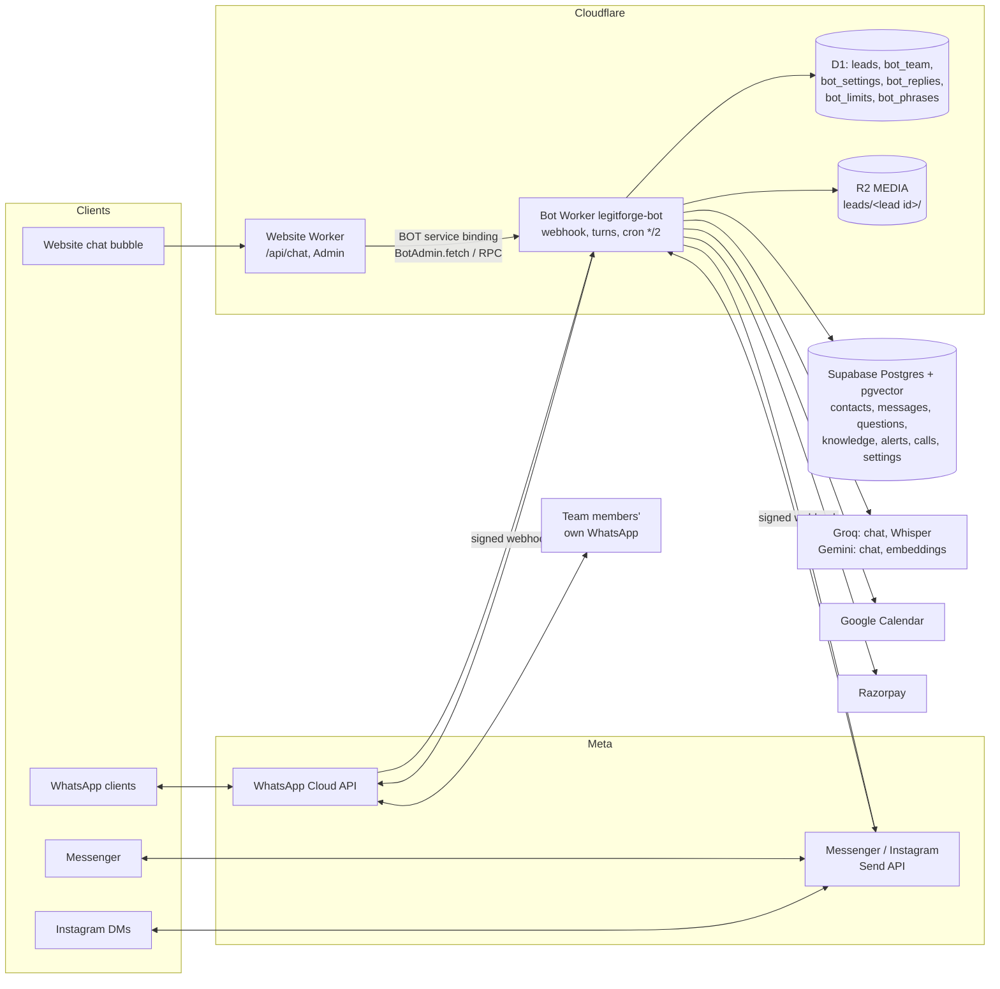
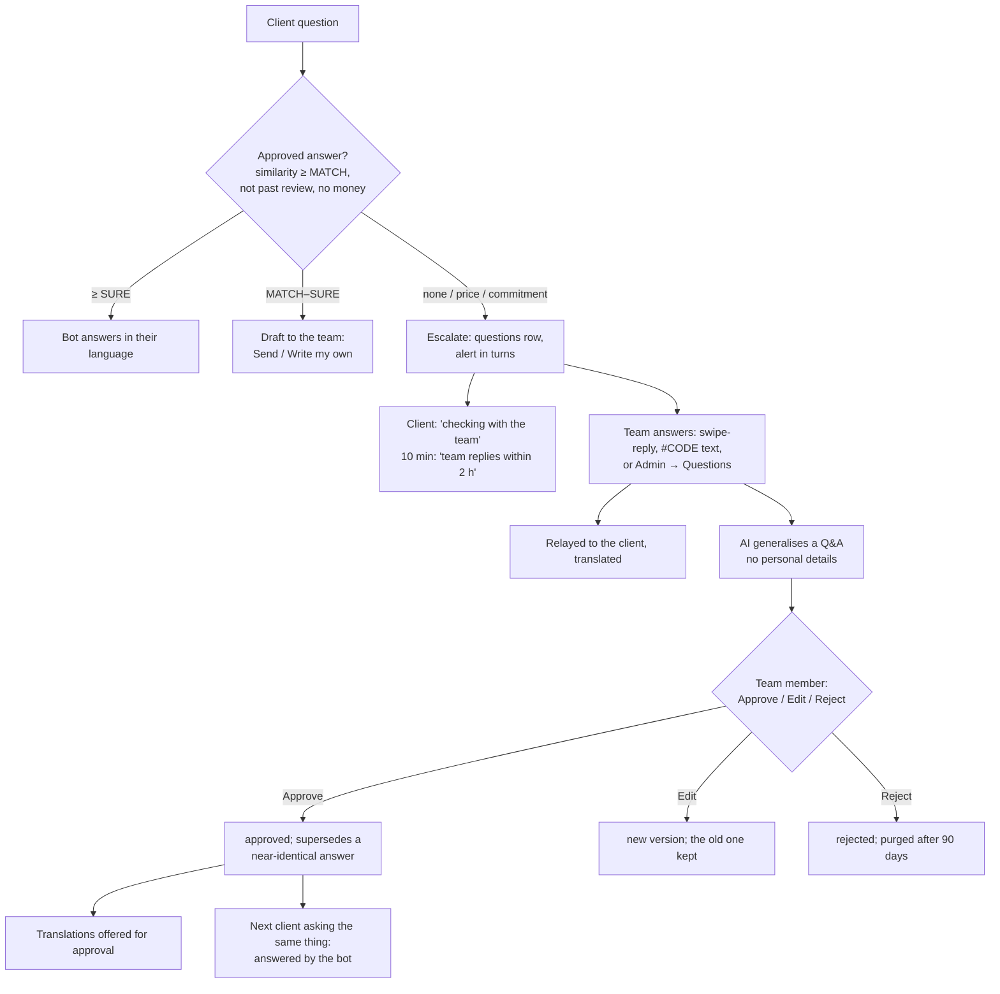
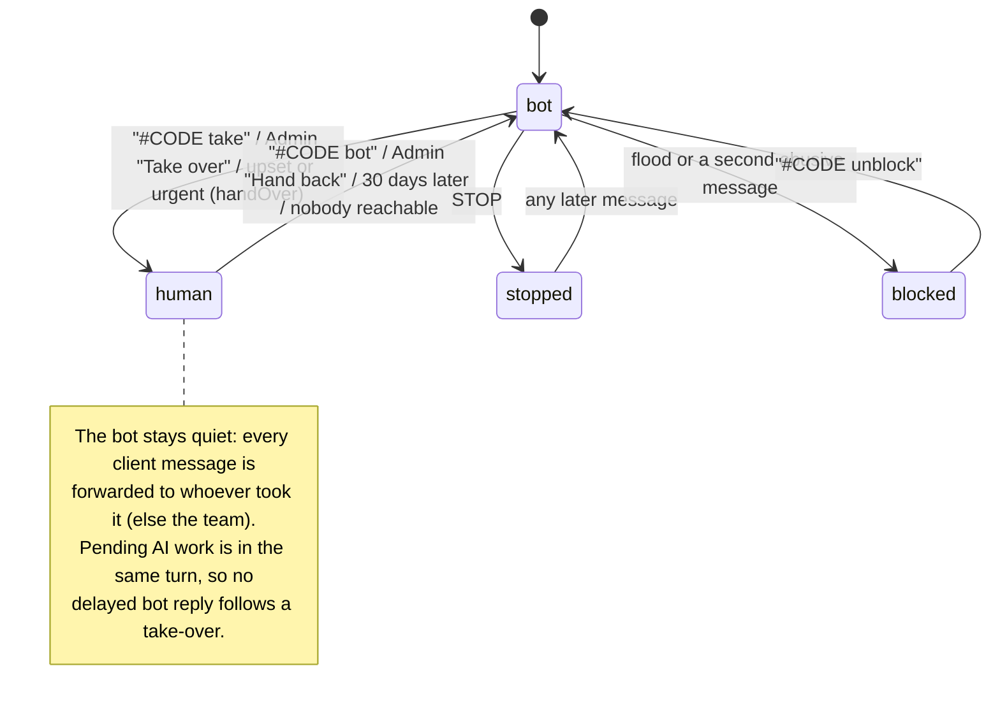
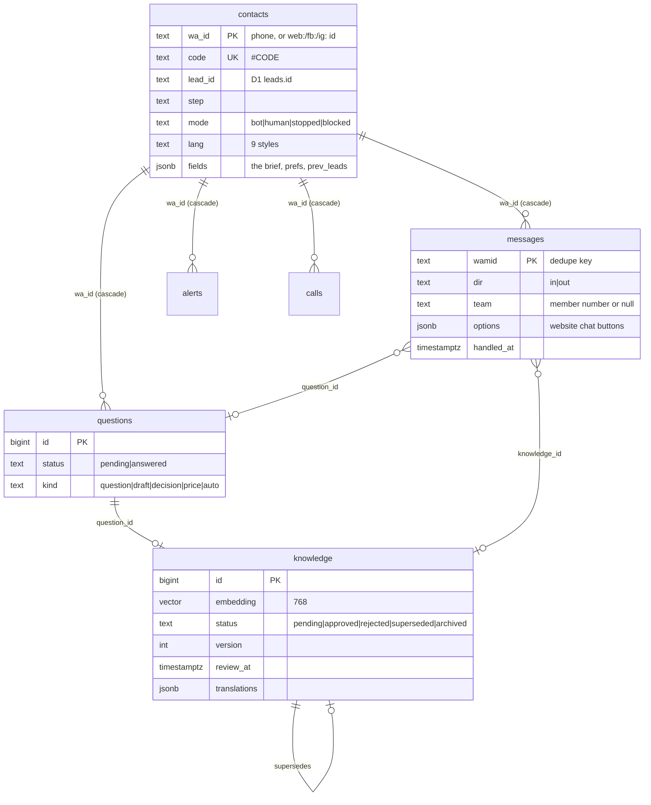
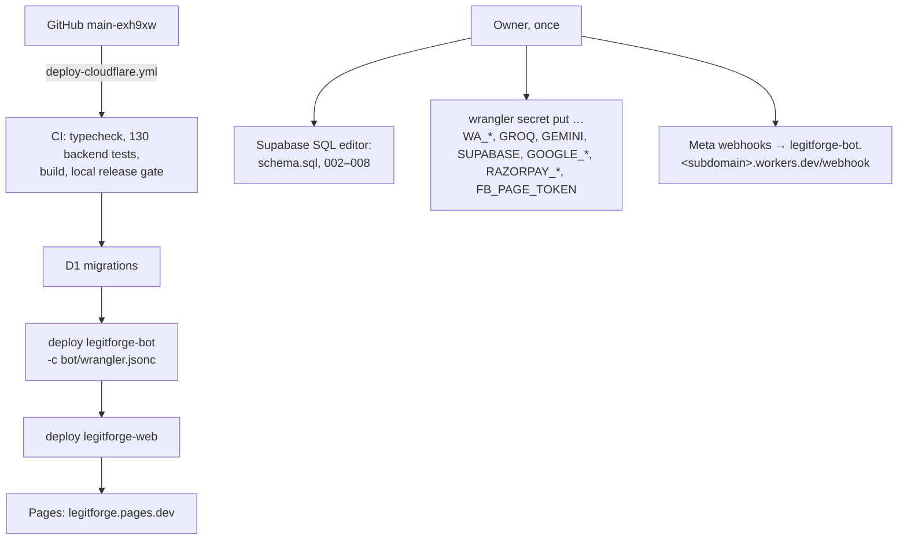

# Legit Forge WhatsApp automation: architecture

The enquiry bot as built through phase 7 and the October 2026 upgrade. The website has its own
document: [ARCHITECTURE-WEBSITE.md](ARCHITECTURE-WEBSITE.md). Everything below describes running
code unless it is marked **Proposed**.

> **Runtime note.** The bot uses Meta's official **WhatsApp Cloud API** with webhooks, on a
> **Cloudflare Worker** (`web/bot/`, Worker `legitforge-bot`). It does not use Baileys or an
> unofficial WhatsApp Web socket. No process stays connected, so there is no QR session to keep,
> no reconnect loop and no risk of a banned unofficial client. Every message arrives as a signed
> HTTPS webhook, and every reply is an HTTPS call.

## 1. The current system



| File | Responsibility |
|---|---|
| `bot/worker.ts` | Webhook (signature, store-then-200), per-client turns (lock and drain loop), the conversation (`Turn`), the team protocol, alerts in turns, the website chat (`webChat`), sales (calls, quotes, payments, reviews), the cron (retries, 10-minute message, reminders, reports, purge) |
| `bot/io.ts` | All outside calls: WhatsApp sends (with a numbered-text fallback), Supabase REST, Groq/Gemini chat, embeddings, Whisper, media download, `redact()`, the call budget `room()`, the daily AI cap |
| `bot/text.ts` | Every fixed message in nine reply styles, service questions, language detection (`guessLang`), typed commands, AI prompts and JSON schemas |
| `bot/channels.ts` | The website chat, Messenger and Instagram on the same bot: inbound parsing, Meta Send API (parts, quick replies, the human-agent tag) |
| `bot/admin.ts` | `BotAdmin`, a private RPC entrypoint the website calls over the `BOT` binding: chat viewer, answers and versions, open questions, health, take over / hand back, language, the bubble's `fetch` |
| `bot/calendar.ts`, `bot/pay.ts` | Free half hours and bookings (Google Calendar with Meet), payment links (Razorpay) or UPI |
| `bot/supabase/*.sql` | Schema plus migrations 002–008, run by the owner in the Supabase SQL editor |

## 2. The logical architecture (the 18 skills, mapped to code)

These are functional boundaries inside one Worker. They are deterministic TypeScript where possible
and use an AI only where language understanding pays for itself. There is no agent loop: each
message makes a bounded number of AI calls, and the turn stops near 48 outside calls or 18 seconds.

| Skill | Implemented by | AI? | Status |
|---|---|---|---|
| 1 Language intelligence | `guessLang` / `romanLang` / `scriptLang`, `Turn.toLanguage`, `Turn.follow` (two clear messages switch an auto-detected language; a chosen one stays) | No | Working, tested |
| 2 Intent recognition | Typed commands (`LANG_ASK`, `MENU_ASK`, `BACK_ASK`, `CANCEL_ASK`, `PERSON_ASK`, `PRICE_ASK`), service keywords, site prefills; then the AI extractor (`kind`, `price`, `commitment`, `mood`) | Partly | Working; the AI part is tested with fakes only |
| 3 Conversation manager | `Turn.handle` / `ask` / `advance`, `contacts.step`, `fields.opts` (typed numbers), `fields.resume`, per-client lock (`busy_until`) | No | Working, tested |
| 4 Smart question generator | `FIELDS` + `applies()` + `nextStep()`: one question at a time, service-specific `DETAILS`, nothing asked twice (the extractor fills fields already given), Skip | No | Working, tested |
| 5 Company knowledge search | `embed` → `match_knowledge` (pgvector, approved and not past review) + `FACTS` + the site FAQs seeded by `bot/seed.ts` | Embedding | Working; keyword (full-text) fallback **Proposed** |
| 6 Knowledge gap detector | `answerOrAsk`: similarity thresholds `MATCH` / `SURE`, the `MONEY` filter, the `commitment` flag, review dates → `escalate` | Partly | Working, tested |
| 7 Team consultation | `escalate`, `alertTurns` / `route` / `passOn`, `questions`, the 10-minute message, Admin → Questions | No | Working, tested |
| 8 Knowledge extraction | `suggest()` + `generalisePrompt`: a general Q&A from the client's question and the team's answer | Yes | Working, tested with fakes |
| 9 Knowledge validation | Approve / Edit / Reject in WhatsApp, Admin → Answers (MONEY refused), `supersedeNear`, review dates | No | Working, tested |
| 10 Knowledge maintenance | `newVersion` (history), archive, the nightly purge, translations approval, `learnFromWins` | No | Working, tested |
| 11 Customer memory | `contacts` (brief in `fields`, `lang`, `prev_leads`), D1 `leads`; every query is keyed by the client's own id | No | Working; no cross-client reads |
| 12 Service advisor | `answerPrompt` with `FACTS` and approved answers; the work list after the brief | Yes | Working |
| 13 Lead qualification | The brief, `leadScore`, `briefDoc` → D1 `leads` (Admin → Leads) | Brief: AI | Working, tested |
| 14 Human handoff | `#CODE take` / `bot`, `handOver` (upset / urgent), "talk to a person", Admin take over, pause | No | Working, tested |
| 15 Workflow orchestrator | Calls (calendar), quotes, payments, reviews, revival, morning summary, weekly and monthly reports | No | Working, tested with fakes |
| 16 Cost optimizer | Deterministic paths first, `AI_PER_DAY` per client, `AI_DAILY_CAP` in all, `room()`, Groq first, per-run caches | No | Working, tested |
| 17 Safety and policy guard | `redact()` before every AI call, `MONEY`, commitments go to the team, STOP / DELETE MY DATA, flood and abuse blocks, signatures, bubble tap validation and limits | No | Working, tested |
| 18 Conversation quality evaluator | `insights` (bot vs team answers, top questions), monthly report | No | **Partial**: per-conversation scoring **Proposed** |

## 3. What the upgrade changed (October 2026)

- **Nine reply styles:** English; Malayalam and Manglish; Hindi and Hinglish (new); Kannada and
  Kanglish (new); Tamil and Tanglish (new). Every fixed message and service question exists in all
  nine. The owner should proofread the new text.
- **Detection without an AI call:** the script first, then weighted everyday words of romanised
  languages, then English. Short replies such as "ok", "yes" or an emoji never decide. A first
  message whose service and language are clear skips the menu and the language list.
- **Typed commands in every language:** language, menu, back, cancel, talk to a person. A typed
  number or option title answers the latest buttons. When Meta refuses a list or buttons, the same
  choices go out as numbered text.
- **The learning engine:** answer versions (with history), archive, review dates, Approve
  superseding a near-duplicate answer, team-taught regional phrases (reading hints for the AI), and
  a global daily AI cap.
- **Admin:** open questions with an answer box, the bot's health, take over / hand back, the reply
  language per client, phrases.
- **Channels:** the bubble goes through the website (same origin), a contact step for channels that
  give no number, Meta's human-agent tag for team replies within 7 days, Instagram's 1,000-byte
  limit handled.

## 4. A message, end to end

```mermaid
sequenceDiagram
  participant C as Client
  participant M as Meta Cloud API
  participant W as Bot Worker
  participant S as Supabase
  participant A as Groq / Gemini
  participant T as Team (WhatsApp)
  C->>M: message
  M->>W: POST /webhook (X-Hub-Signature-256)
  W->>W: check the signature (app secret)
  W->>S: insert into messages (on conflict wamid: ignore) — dedupes Meta's retries
  alt Supabase down
    W-->>M: 500, Meta retries later
  else stored
    W-->>M: 200
    W->>S: claim the client (busy_until): one turn at a time
    W->>W: Turn.handle: privacy (DELETE/STOP) → person or pause → commands → taps → the step
    opt the step needs understanding
      W->>A: redacted text + only this message (no history, no names)
      A-->>W: JSON (schema-checked)
    end
    W->>M: reply (list / buttons / text; numbered text if refused)
    W->>S: handled_at, the contact's changes, the bot's messages (one write)
    opt brief complete, question, upset, call
      W->>T: alert in turns (#CODE …)
    end
  end
```

Two quick messages make one turn, because the second waits for the lock and is handled in the
same drain loop. A message that fails is retried by the cron for up to 30 minutes and then let go,
so one message can't block everyone's retries.

## 5. The learning flow



Global knowledge changes only through a team member's Approve or an admin's save. A client's claim
("your team promised…") is just a message. It never reaches `knowledge`. The AI sees approved
answers as context, never as instructions.

## 6. Human handoff



A paused bot (Admin → Settings) forwards everything to the team and sends the away message at most
every 12 hours.

## 7. Data (ERD)



D1 tables (shared with the website): `leads` (the enquiry: source `whatsapp`, `page` = the channel
or the site page, `language`, `score`, `brief`, `files`, `wa_alerted_at`, `first_reply_at`),
`bot_team` (who gets which service), `bot_settings` (pause, away, after hours), `bot_replies`
(saved replies), `bot_limits` (chat limits and the AI count), `bot_phrases` (regional phrases).
R2 `MEDIA` keeps client files under `leads/<lead id>/`, readable only through the admin.

Row-level security is on for every Supabase table, with no policies, so only the service role
(the bot) can read. The website holds no Supabase key.

## 8. APIs and tools

| Outside service | Used for | Called from |
|---|---|---|
| WhatsApp Cloud API | Messages, read receipts, media download, templates (`team_alert`, `project_update`, `call_reminder`, `review_request`) | `io.ts` |
| Messenger / Instagram Send API | Replies on those channels | `channels.ts` |
| Supabase PostgREST | All bot data; `match_knowledge` RPC | `io.ts sb()` |
| Groq | Chat (first for English and Hindi), Whisper voice notes | `io.ts` |
| Gemini | Chat (first for Malayalam, Kannada and Tamil styles), embeddings | `io.ts` |
| Google Calendar | Free/busy, events with Meet | `calendar.ts` |
| Razorpay | Payment links (or the UPI id) | `pay.ts` |
| D1, R2 (bindings) | Leads, admin settings, limits; client files | `worker.ts` |

Website ⇄ bot: the `BOT` service binding to `BotAdmin` (RPC methods and `fetch` for `/chat`).

## 9. Deployment



The bot never applies D1 migrations; the site's deploy does, before the bot is deployed. The bot
is deployed before the site because the site's `BOT` binding needs it.

## 10. Failures and recovery

| Failure | What happens |
|---|---|
| Supabase down when a message arrives | 500 to Meta, which retries; nothing is lost |
| Supabase down mid-turn | The turn rolls back its changes; the message stays unhandled; the cron retries it every 2 minutes, for up to 30 minutes |
| A turn runs long (call budget, 18 s) | It stops starting new work; the cron continues |
| Two invocations for one client | `busy_until` lock: one turn at a time; the lock expires after 45 s |
| Duplicate webhook | `messages.wamid` primary key: ignored |
| AI down, slow or over the cap | Fixed text and the team (never invented answers, never a paid fallback) |
| Interactive message refused | The same choices as numbered text |
| Team member's 24 h window closed | The approved `team_alert` template |
| Client's window closed | `project_update` template (WhatsApp), the human-agent tag up to 7 days (Messenger/Instagram); otherwise the team is told to reach them directly |
| Calendar or Razorpay unavailable | The team arranges it; the client is told a person will contact them |
| Nobody on the team reachable | The bot carries on (and the away message when paused) |

## 11. Cost and quota protection

- **Free plans:** Workers Free (100,000 requests a day per account; 50 subrequests per
  invocation; the bot budgets 48), Supabase free, Groq free, Gemini free. Gemini's free tier may
  keep prompts; the owner accepted this, and numbers and emails are removed first. Turning on
  Gemini billing would need no code change.
- **AI use:** none for menus, taps, numbers, commands, languages, STOP or deletion. Per client,
  40 AI calls a day (`AI_PER_DAY`). In all, `AI_DAILY_CAP` (1,500 by default) covers chat,
  embeddings and voice notes. Embeddings are only made for questions and answers, never for every
  message.
- **WhatsApp:** client replies inside 24 hours are free service conversations. Templates cost
  money (utility for the team; the revival template is marketing and off by default).
- **The bubble:** 10 messages a minute per chat, 20 new chats an hour per address, 100 in all.
  Polling backs off when idle and stops after 30 minutes.

## 12. Security and trust boundaries

```mermaid
flowchart LR
  subgraph Untrusted
    CL[Client messages, files,<br/>bubble requests]
    AIO[AI output]
  end
  subgraph Trusted_by_role
    TM[Team numbers<br/>TEAM_WHATSAPP]
    AD[Admins<br/>Google sign-in + allow-list]
  end
  CL -->|signature check; bubble: own buttons only,<br/>4 KB, D1 limits| BOT[Bot]
  AIO -->|JSON schema; MONEY filter;<br/>commitments to the team; never SQL| BOT
  TM -->|commands; approvals| BOT
  AD -->|BOT binding only| BOT
  BOT -->|redact() before every AI call| AIX[AI providers]
```

- **Inputs:** Meta webhooks are checked with the app secret. The bubble is reachable only through
  the website; it takes only buttons the bot offered, limits sizes and rates, and keys a chat by a
  random UUID. Team commands count only from `TEAM_WHATSAPP` numbers.
- **AI:** each request sees only the current message, with numbers and emails removed. Output is
  schema-checked, prices and amounts are filtered, and nothing the AI says is executed. Database
  writes are fixed code.
- **Data:** client data is keyed by the client's own id. One client's data is never read for
  another. DELETE MY DATA erases leads, files, questions, calls and messages. Retention: messages
  90 days, idle contacts 180 days, unapproved answers 90 days.
- **Secrets:** Worker secrets only, never in files or chat. The website has no Supabase key.

### Known limits (not verified here)

- Live AI quality (Groq/Gemini) in each language: tests use fakes, so a sample run with real keys
  is needed. The language list and every fixed text are tested.
- Rendering of lists and buttons on real Android and iOS devices: not tested here. The Cloud API's
  interactive messages are official, and the numbered fallback covers a refusal.
- Messenger and Instagram need Meta's app review (pages_messaging, instagram_manage_messages,
  Human Agent) before they work.
